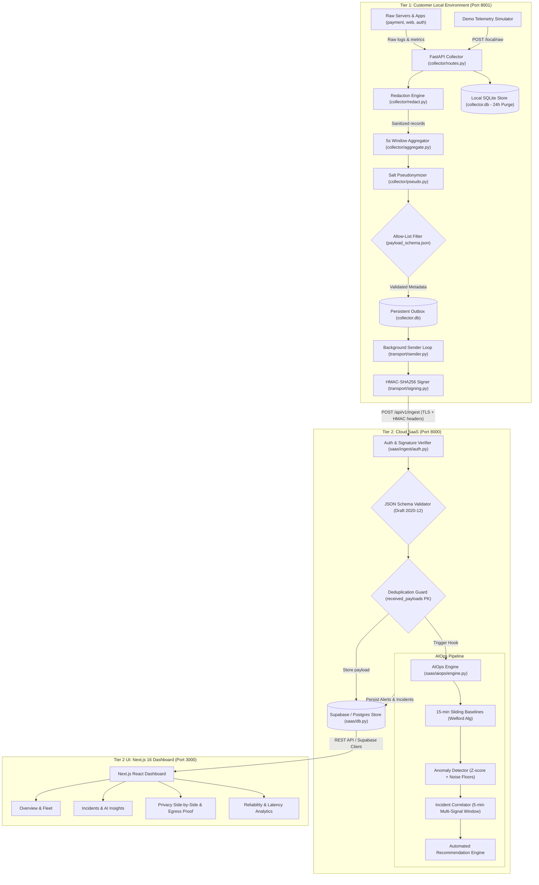

# Chapter 2: Technical Architecture & Workflows

## 1. High-Level Component Boundaries

Velocity Cicada is architected into 5 discrete subsystems connected by strict contracts:



---

## 2. Directory Structure & File Ownership

The project repository is structured into clear ownership layers:

```
velocity cicada/
├── collector/                 # TIER 1: Customer Collector (FastAPI on Port 8001)
│   ├── adapters/simulator.py  # Adapts incoming records to canonical format
│   ├── aggregate.py           # 5-second aggregation window builder
│   ├── app.py                 # FastAPI lifecycle, background loops & routes
│   ├── config.py              # Collector environment configuration
│   ├── demo_driver.py         # 9 scenario simulation generator
│   ├── detect.py              # Local health assessment
│   ├── pseudo.py              # HMAC-SHA256 salt host pseudonymization
│   ├── redact.py              # Regex credential and PII redaction engine
│   ├── routes.py              # /local/raw, /local/detections, /local/demo
│   └── store.py               # Local SQLite database (24h retention)
│
├── transport/                 # TIER 1 -> TIER 2: Egress & Outbox Subsystem
│   ├── db.py                  # Outbox SQLite queue & delivery state
│   ├── router.py              # /local/egress, /local/buffer, /local/saas-link
│   ├── sender.py              # Background polling sender with exponential backoff
│   └── signing.py             # HMAC-SHA256 request signing & timestamp header
│
├── saas/                      # TIER 2: Cloud SaaS Backend (FastAPI on Port 8000)
│   ├── app.py                 # SaaS FastAPI application & router mounting
│   ├── config.py              # SaaS settings, Supabase URL & keys
│   ├── db.py                  # Database abstraction (SupabaseStore & SqliteStore)
│   ├── ingest/
│   │   ├── auth.py            # HMAC signature verification & JWT tenant extraction
│   │   └── routes.py          # /api/v1/ingest, /api/v1/heartbeat, /api/v1/reliability
│   └── aiops/
│       ├── baseline.py        # Welford algorithm rolling 15-minute baselines
│       ├── correlate.py       # Multi-source incident clustering & alert grouping
│       ├── detect.py          # Z-score anomaly detector with noise floors
│       ├── engine.py          # Ingest hook orchestrator
│       ├── health.py          # State evaluation (excellent, good, fair, poor)
│       ├── recommend.py       # Automated remediation proposals with rollback
│       └── routes.py          # /api/v1/overview, /api/v1/incidents, /api/v1/alerts
│
├── contracts/                 # Cross-boundary API schemas & rules
│   ├── payload_schema.json    # JSON Schema Draft 2020-12 for wire metadata
│   ├── heartbeat_schema.json  # Schema for collector liveness heartbeats
│   ├── redaction_rules.json   # 11 regex patterns for sensitive strings
│   ├── health_thresholds.json # Static degradation boundaries
│   └── supabase/001_init.sql  # Supabase PostgreSQL tables & RLS policies
│
└── dashboard/                 # Next.js 16 Executive Observability Dashboard
    ├── src/app/               # App Router pages (layout, page.tsx, globals.css)
    ├── src/components/        # Dashboard layout, Sidebar, Header, Modal
    │   └── dashboard/views/   # All 11 dedicated observability views
    └── src/lib/               # Supabase client, REST API connector, live polling
```
