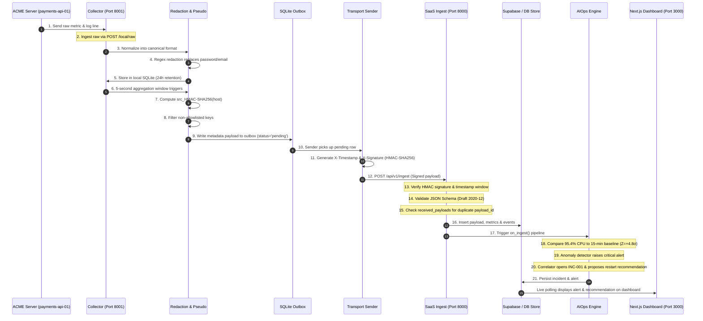

# Chapter 3: End-to-End Data Flow (The 21-Step Journey)

## The Real-World Scenario: ACME Payments API CPU Spike

To understand the complete lifecycle of telemetry in Velocity Cicada, follow this real-world event:
> **Incident Scenario**: The ACME Corporation operates a payments cluster. At 14:00 UTC, the server `payments-api-01` suddenly spikes to **95.4% CPU usage** due to a runaway crypto calculation. Simultaneously, the application log writes a line containing an internal database connection password and customer email address.

Here is the exact 21-step journey from raw telemetry to executive dashboard resolution:

---

---

## Detailed Step-by-Step Breakdown

### Step 1: Server Generates Raw Telemetry
- **Component**: Application Server (`payments-api-01`).
- **Input**: OS metrics (`cpu: 95.4`, `mem: 78.1`) and log line: `DB connection to postgres://admin:P@ssw0rd123@db.internal failed for user alice@acme.com`.
- **Output**: JSON event posted to collector endpoint.
- **Implemented in**: `collector/demo_driver.py` / application agent.

### Step 2: Collector Receives Raw Data
- **Component**: `collector/routes.py` (`POST /local/raw`).
- **Processing**: Receives payload, validates JSON structure, increments atomic `_records_in_count`.
- **Manual Verification**: Run `curl -X POST http://localhost:8001/local/raw -H "Content-Type: application/json" -d '{"host":"payments-api-01","kind":"log","message":"secret test"}'`.

### Step 3: Canonical Adapter Normalization
- **Component**: `collector/adapters/simulator.py` (`adapt_to_raw_record`).
- **Processing**: Enforces consistent fields: `host`, `kind`, `service`, `metrics`, `timestamp_utc`.

### Step 4: Local Regex Redaction
- **Component**: `collector/redact.py` (`RedactionEngine.redact_structure`).
- **Processing**: Matches `P@ssw0rd123` against regex rule `password_assignment` and replaces it with `[REDACTED:password_assignment]`. Matches `alice@acme.com` and replaces it with `[REDACTED:email]`.
- **Output**: Sanitized canonical dictionary + count of redacted secrets.

### Step 5: Local Encrypted SQLite Persistence
- **Component**: `collector/store.py` (`store_raw_record`).
- **Processing**: Saves both original and redacted records into local `collector/data/collector.db`. These records **never leave** the customer site and are automatically purged after 24 hours.

### Step 6: 5-Second Window Aggregation
- **Component**: `collector/aggregate.py` (`build_payload`).
- **Processing**: Runs every 5 seconds. Gathers all sanitized records in memory, computes statistical metrics (min, max, mean, p95), and increments the window sequence number.

### Step 7: Pseudonymization with Secret Salt
- **Component**: `collector/pseudo.py` (`source_id`).
- **Processing**: Takes `payments-api-01`, computes `hmac_sha256(SITE_SALT, "payments-api-01")[:12]`, producing `src_7a9f2b1c4e80`. The SaaS cloud only ever sees `src_7a9f2b1c4e80`.

### Step 8: Strict Allow-List Enforcement
- **Component**: `collector/aggregate.py`.
- **Processing**: Strips all raw messages, unapproved tags, and unrecognized keys. Only fields defined in `contracts/payload_schema.json` are retained in the egress payload dictionary.

### Step 9: Persistent Disk Outbox Queuing
- **Component**: `transport/db.py` (`queue_payload`).
- **Processing**: Atomically writes payload to SQLite table `outbox` with `status='pending'`, generating a UUIDv4 `payload_id` and monotonic `seq` number.

### Step 10: Sender Polling & Outbox Processing
- **Component**: `transport/sender.py` (`_sender_loop`).
- **Processing**: Fetches the oldest pending payload from SQLite ordered by `seq ASC`.

### Step 11: HMAC-SHA256 Wire Signing
- **Component**: `transport/signing.py` (`sign`).
- **Processing**: Computes:
  $$\text{X-Signature} = \text{hex}\Big(\text{HMAC-SHA256}\big(K_{\text{collector}}, \text{timestamp} \,\|\, \text{"."} \,\|\, \text{raw\_body}\big)\Big)$$
- **Output**: HTTP headers `X-Timestamp`, `X-Signature`, `X-Collector-Id`.

### Step 12: Wire Transmission
- **Component**: HTTP POST request from `transport/sender.py` to `http://localhost:8000/api/v1/ingest`.

### Step 13: SaaS Authentication Verification
- **Component**: `saas/ingest/auth.py` (`verify_collector_auth`).
- **Processing**: Looks up collector pre-shared secret, verifies timestamp skew is $< 300\text{s}$, and validates HMAC signature using constant-time comparison `hmac.compare_digest`.

### Step 14: SaaS Schema Validation
- **Component**: `saas/ingest/routes.py` (`Draft202012Validator`).
- **Processing**: Validates incoming payload against `contracts/payload_schema.json`. If invalid keys or types exist, returns `HTTP 422 Unprocessable Entity`.

### Step 15: Deduplication & Idempotency Check
- **Component**: `saas/db.py` (`record_payload`).
- **Processing**: Tries inserting `payload_id` into `received_payloads`. If primary key exists, raises `DuplicatePayload` and returns `HTTP 200 {"status": "duplicate"}` without reprocessing.

### Step 16: Metadata Ingestion & Storage
- **Component**: `saas/db.py`.
- **Processing**: Inserts aggregated metrics into `metrics` table with `event_time_utc`.

### Step 17: AIOps Ingestion Hook
- **Component**: `saas/aiops/engine.py` (`on_ingest`).
- **Processing**: Dispatches payload to the AIOps evaluation pipeline.

### Step 18: Welford 15-Minute Baseline Calculation
- **Component**: `saas/aiops/baseline.py` (`MetricBaseline.zscore`).
- **Processing**: Retrieves 15-minute rolling mean (e.g., $22.4\%$) and standard deviation (e.g., $\pm 8.1\%$) for `cpu_pct`. Computes:
  $$Z = \frac{95.4 - 22.4}{8.1} \approx +9.01\sigma$$

### Step 19: Anomaly Detection with Noise Floors
- **Component**: `saas/aiops/detect.py`.
- **Processing**: $Z = +9.01\sigma$ exceeds $Z_{\text{poor}} = 4.5\sigma$ and delta $(95.4 - 22.4 = 73.0\%)$ exceeds noise floor ($2.0\%$). Raises **Critical Threshold Anomaly**.

### Step 20: Incident Correlation & Automated Recommendation
- **Component**: `saas/aiops/correlate.py` & `saas/aiops/recommend.py`.
- **Processing**: Clusters anomaly with recent alerts into `INC-001 ("Sustained CPU exhaustion on payments service")`. Proposes recommendation `scale_worker_pool` with automated rollback plan and policy check.

### Step 21: Executive Dashboard Live Display
- **Component**: Next.js 16 Dashboard (`OverviewView.tsx` & `IncidentsView.tsx`).
- **Processing**: Polls `/api/v1/overview` and displays the health state drop to **POOR**, the live anomaly card, and the one-click approval button for the mitigation recommendation.
