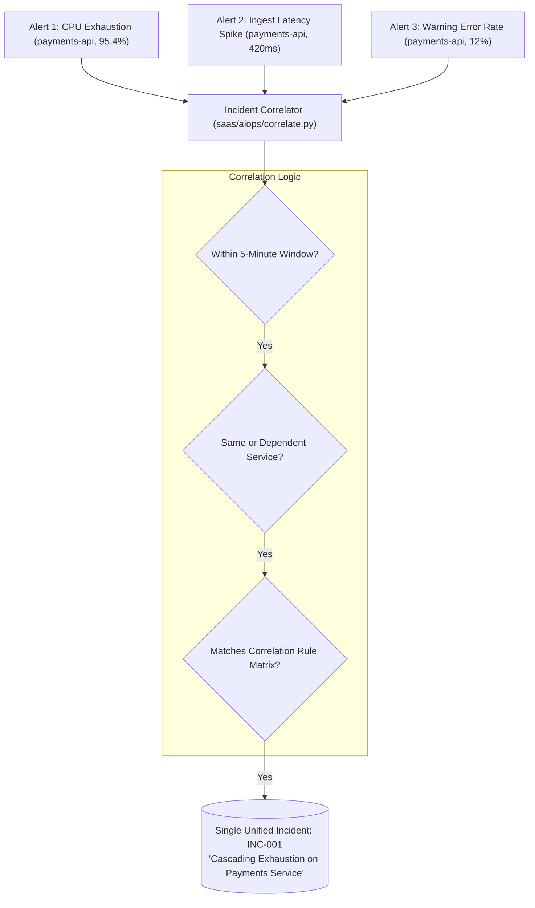

# Chapter 5: AIOps Engine, Baselines & Incident Correlation

## 1. Mathematical Foundation: The Welford Baseline Algorithm

Traditional monitoring tools store thousands of raw data points to compute standard deviations, consuming massive memory.
Velocity Cicada utilizes **Welford's Algorithm** (`saas/aiops/baseline.py`) for numerically stable, single-pass running variance and mean over a sliding 15-minute window.

For each incoming metric value $x$:
$$n \leftarrow n + 1$$
$$\delta \leftarrow x - \mu_{n-1}$$
$$\mu_n \leftarrow \mu_{n-1} + \frac{\delta}{n}$$
$$\delta_2 \leftarrow x - \mu_n$$
$$M_{2,n} \leftarrow M_{2,n-1} + \delta \cdot \delta_2$$
$$\sigma_n = \sqrt{\frac{M_{2,n}}{n - 1}}$$

### Memory Footprint:
Instead of retaining 180 samples in memory for a 15-minute window, the baseline stores only **3 float numbers**:
- `count` ($n$)
- `mean` ($\mu$)
- `M2` (sum of squared deviations)

---

## 2. Dynamic Anomaly Detection (Z-Score & Noise Floors)

When a new metric arrives, `saas/aiops/detect.py` calculates its statistical deviation ($Z$-score):
$$Z = \frac{x - \mu}{\sigma}$$

### Anomaly Threshold Classifications:
- **Normal ($Z \le 2.0\sigma$)**: Expected operational variance.
- **Fair Warning ($2.0\sigma < Z \le 3.0\sigma$)**: Moderate deviation, flagged for trending.
- **Poor / Critical ($Z > 4.5\sigma$)**: Severe operational anomaly, triggers automated incident escalation.

### Noise Floor Protection:
In low-traffic environments, a server whose CPU hovers at $1.0\% \pm 0.05\%$ might trigger a $Z = +10.0\sigma$ alert when CPU rises to only $1.6\%$.
Velocity Cicada prevents false alarms by enforcing **hard noise floors** (`saas/aiops/detect.py`):

| Metric | Configured Noise Floor | Behavior |
| :--- | :--- | :--- |
| `cpu_pct` | $2.0\%$ | Ignores Z-score deviations if $|x - \mu| \le 2.0\%$ |
| `mem_pct` | $2.0\%$ | Ignores Z-score deviations if $|x - \mu| \le 2.0\%$ |
| `disk_pct` | $1.0\%$ | Ignores Z-score deviations if $|x - \mu| \le 1.0\%$ |
| `latency_ms` | $5.0\text{ms}$ | Ignores Z-score deviations if $|x - \mu| \le 5.0\text{ms}$ |
| `packet_loss_pct` | $0.2\%$ | Ignores Z-score deviations if $|x - \mu| \le 0.2\%$ |
| `bandwidth_mbps` | $25.0\text{ Mbps}$ | Prevents alert flapping on normal burst traffic |

---

## 3. Incident Correlation: Clustering Multi-Signal Cascades

When an infrastructure failure occurs, multiple metrics collapse simultaneously (e.g., high CPU causes latency to spike, which causes connection timeouts, which causes failed health checks).

Traditional observability tools generate **5 separate pages**, flooding engineers.
Velocity Cicada's Incident Correlator (`saas/aiops/correlate.py`) groups alerts into a **single consolidated incident**:



---

## 4. Automated Recommendations with Policy Guardrails

Every generated incident triggers the Recommendation Engine (`saas/aiops/recommend.py`), proposing concrete remediation actions:

```json
{
  "rec_id": "rec_3b8a1c9e",
  "incident_id": "inc_payments_cpu",
  "action": "scale_horizontal_replicas",
  "parameters": {
    "service": "payments-api",
    "current_replicas": 2,
    "target_replicas": 5
  },
  "confidence": 0.94,
  "risk": "low",
  "requires_approval": true,
  "policy_check": {
    "allowed": true,
    "policy": "autoscale_max_limit_under_10"
  },
  "rollback_plan": "scale_horizontal_replicas to 2 if error rate does not decline in 180s",
  "status": "proposed"
}
```

### Safety Features:
1. **Automated Policy Pre-Check**: Checks if the remediation violates enterprise constraints (e.g., spending limits or max replica count).
2. **Explicit Rollback Plan**: Every proposed action specifies an automated rollback sequence.
3. **One-Click Human Approval**: High-risk actions require human authorization via the dashboard or `POST /api/v1/recommendations/{id}/approve`.
