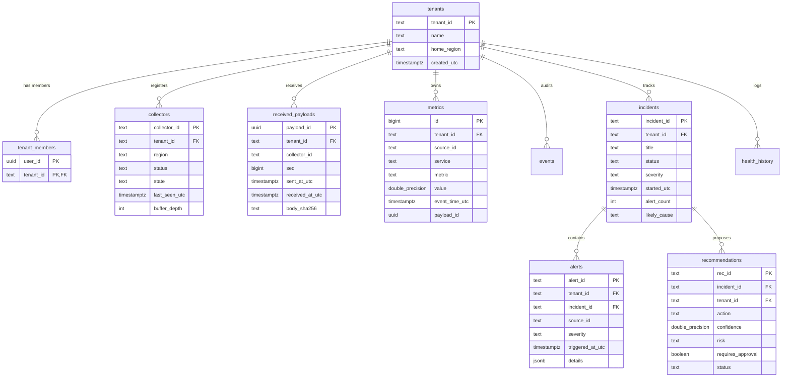

# Chapter 7: Database Guide, Schema & Multi-Tenancy

## 1. Supabase Schema Architecture

Velocity Cicada utilizes a multi-tenant PostgreSQL schema (`contracts/supabase/001_init.sql`) with dual-engine support (`SupabaseStore` for production cloud deployment, and localized `SqliteStore` for offline demonstration).



---

## 2. Table-by-Table Reference

### 1. `tenants`
- **Purpose**: Defines isolated organization accounts.
- **Key Columns**: `tenant_id` (PK, e.g., `t_acme`, `t_globex`), `home_region` (`ap-south-1`, `eu-west-1`, `us-east-1`).
- **Access**: Read by auth middleware; written during onboarding.

### 2. `tenant_members`
- **Purpose**: Maps Supabase authenticated users (`auth.users.id`) to tenants.
- **Security Role**: Backs the RLS function `my_tenants()` so users can only view their organization's data.

### 3. `collectors`
- **Purpose**: Real-time registry of all deployed collector instances.
- **Key Columns**: `collector_id`, `tenant_id`, `status` (`online` \| `offline`), `buffer_depth`, `last_seen_utc`.
- **Liveness Guarantee**: If no heartbeat is received for $> 60\text{s}$, marked `offline`.

### 4. `received_payloads`
- **Purpose**: Primary gate for **Idempotency** and **Replay Protection**.
- **Constraint**: `payload_id` (UUIDv4) is the PRIMARY KEY.
- **Deduplication**: Inserting a duplicate payload ID throws a unique constraint violation, returning `duplicate` without re-inserting metrics.

### 5. `metrics`
- **Purpose**: Time-series store for statistical metric aggregations.
- **Ordering Guarantee**: Contains both `event_time_utc` (when the event occurred on the server) and `received_at_utc` (when it reached SaaS). Queries always sort by `event_time_utc`, guaranteeing correct graph rendering even if packets arrived out of order.

### 6. `incidents`
- **Purpose**: High-level problem grouping.
- **Key Columns**: `incident_id`, `tenant_id`, `severity`, `status` (`open` \| `investigating` \| `resolved`), `likely_cause`.

### 7. `alerts`
- **Purpose**: Individual threshold breaches and statistical anomalies.
- **Key Columns**: `alert_id`, `incident_id` (nullable foreign key), `source_id`, `details` (stores Z-score and baseline stats).

### 8. `recommendations`
- **Purpose**: Remediation proposals generated by the AIOps engine.
- **Key Columns**: `rec_id`, `incident_id`, `action`, `confidence`, `status` (`proposed` \| `approved` \| `executed_simulated` \| `rolled_back`).

---

## 3. Multi-Tenant Isolation & Row Level Security (RLS)

Velocity Cicada achieves 100% cryptographic and logical tenant separation:

1. **Database Row Level Security (PostgreSQL RLS)**:
   ```sql
   create policy tenant_isolation_policy on metrics
     for all using (tenant_id in (select my_tenants()));
   ```
2. **FastAPI Service-Role Enforcement**:
   - The backend runs under the Supabase Service Role (bypassing RLS for fast ingestion writes).
   - Every single SQL query constructed in `saas/db.py` explicitly injects `WHERE tenant_id = :tenant_id`.
3. **Data Residency Isolation**:
   - For customers requiring sovereign physical separation, the system supports dedicated regional databases (e.g., `saas/data/ap-south-1.db`, `eu-west-1.db`, `us-east-1.db`). ACME telemetry never touches European or American disk storage.
