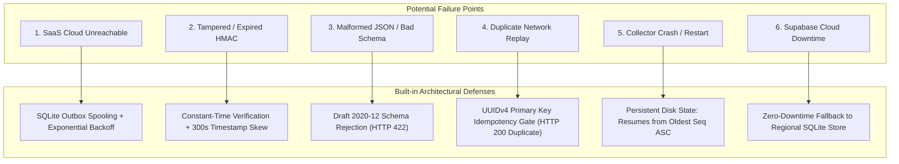

# Chapter 11: Failure Recovery & Edge Case Resilience

## 1. Resilience Philosophy

Velocity Cicada is architected under the principle of **Failure As Normal Operation**. Every network link, service boundary, and database connection is assumed to be intermittent, flaky, or actively hostile.



---

## 2. Failure Case-by-Case Breakdown

### Failure Case 1: SaaS Cloud Server Offline or Network Link Severed
- **What Happens**: `transport/sender.py` attempts `POST /api/v1/ingest` and catches `httpx.ConnectError` or timeout.
- **Handling**:
  1. Marks link status as disconnected.
  2. Increments `attempts` counter in local `outbox` table.
  3. Applies exponential backoff: $t_{\text{wait}} = \min(60, 2^{\text{attempts}})$.
  4. Incoming telemetry continues to accumulate safely on local disk (`collector/data/collector.db`).
- **Recovery**: When the SaaS endpoint responds with HTTP 200, the sender flushes the outbox backlog in strict monotonic order (`seq ASC`).

### Failure Case 2: Tampered Payload or Invalid HMAC Signature
- **What Happens**: An attacker alters payload contents or replays an old packet beyond the 300-second window.
- **Handling**: `saas/ingest/auth.py` checks:
  ```python
  if abs(time.time() - timestamp) > 300:
      raise HTTPException(401, "Timestamp skew exceeded")
  if not hmac.compare_digest(expected_sig, received_sig):
      raise HTTPException(401, "Invalid HMAC signature")
  ```
- **Outcome**: The request is dropped immediately before schema validation or database insertion.

### Failure Case 3: Malformed JSON or Schema Violation
- **What Happens**: Telemetry with unauthorized fields arrives.
- **Handling**: `saas/ingest/routes.py` runs `Draft202012Validator.iter_errors()`.
- **Outcome**: Returns `HTTP 422 Unprocessable Entity` with a list of offending fields. Unvalidated fields never enter the database.

### Failure Case 4: Duplicate Payload Retransmission
- **What Happens**: A slow network causes the collector to re-send an already processed payload.
- **Handling**: The database table `received_payloads` has a PRIMARY KEY constraint on `payload_id` (UUIDv4).
- **Outcome**: The insert raises a duplicate violation. The API catches it, logs a duplicate reject metric, and returns `HTTP 200 {"status": "duplicate"}`. Metrics and alerts are **not duplicated**.

### Failure Case 5: Collector Process Abruptly Killed / Crashes
- **What Happens**: Operating system kills the collector process during a power failure.
- **Handling**: Because outbox records are written using **SQLite Write-Ahead Logging (WAL)** before transmission, zero queued payloads are lost in memory.
- **Outcome**: When the collector starts back up, `transport/sender.py` resumes processing the lowest unsent sequence number immediately.

### Failure Case 6: Supabase Cloud Database Outage
- **What Happens**: Cloud Supabase experiences an outage or network partition.
- **Handling**: The SaaS storage layer (`saas/db.py`) falls back seamlessly to local regional SQLite databases (`saas/data/{region}.db`).
- **Outcome**: Telemetry ingestion and AIOps continue uninterrupted offline.
