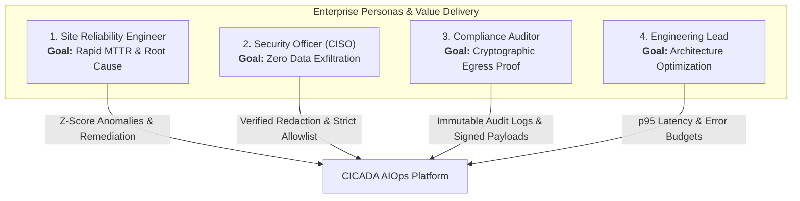
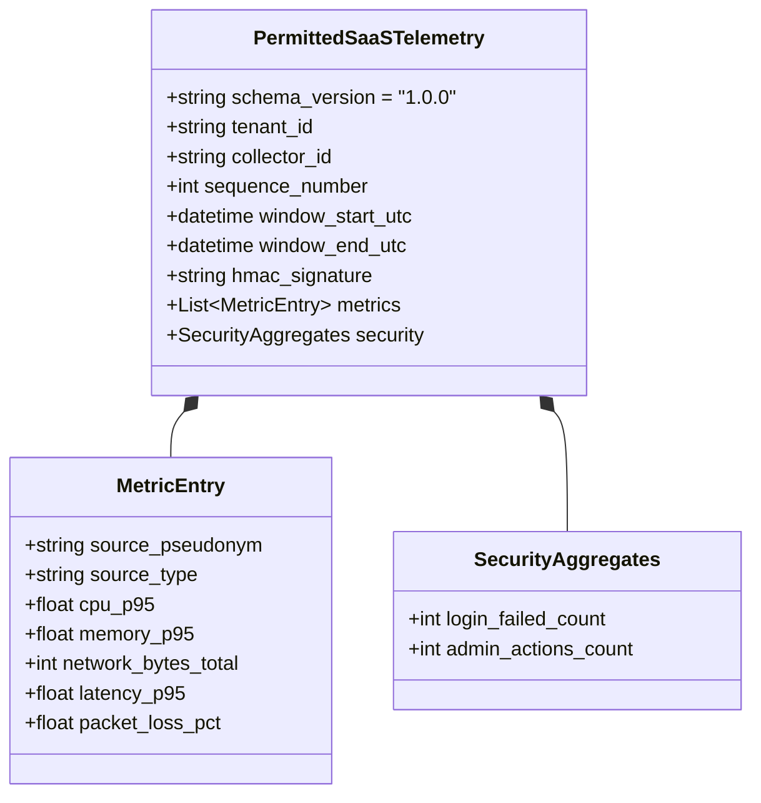
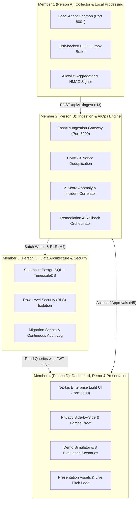

# CICADA 2026 — Phase 1: Ideation, Trust Boundary & MVP Scope

**Project**: CICADA (Continuous Intelligence & Cryptographic Architecture for Decentralized AIOps)  
**Hackathon**: CICADA 2K26  
**Module**: Phase 1 Deliverable — Problem Definition, Privacy Model & Team Architecture  
**Author**: Member 4 (Dashboard, Demo & Presentation Lead) on behalf of the CICADA Engineering Team  

---

## 1. Problem Statement & The Enterprise Observability Dilemma

Enterprise organizations operating in regulated sectors (finance, healthcare, defense, and multinational commerce) face an intractable conflict between **operational reliability** and **data sovereignty**:

1. **The Modern AIOps Mandate**: Cloud-native architectures generate billions of operational signals daily. To diagnose distributed microservice regressions, predict outages, and automate remediation, SRE teams require centralized AIOps intelligence.
2. **The Cloud Privacy Wall**: Centralized cloud-hosted observability platforms (e.g., Datadog, New Relic, Dynatrace) require streaming raw operational logs, stack traces, and system payloads across the enterprise perimeter into multi-tenant cloud SaaS.
3. **The Data Breach Reality**: Production logs routinely and inadvertently capture sensitive data:
   - Plaintext authentication tokens, passwords, and bearer keys (`password=hunter2`, `Authorization: Bearer ...`).
   - Personally Identifiable Information (PII) such as customer names, email addresses, and national IDs.
   - Payment Card Industry (PCI) data, medical records (HIPAA), and proprietary intellectual property.

Shipping raw telemetry across public boundaries exposes organizations to catastrophic regulatory penalties (GDPR Article 83 fines up to €20M / 4% global turnover, HIPAA violations up to \$1.9M/year), vendor data lock-in, and severe third-party supply-chain compromise.

---

## 2. Why Traditional Monitoring Tools Are Insufficient

Existing observability tooling fails to resolve this tension due to fundamental architectural flaws:

| Existing Tooling Type | Fundamental Architectural Flaw | Failure Mode in Enterprise Environments |
| :--- | :--- | :--- |
| **Traditional SaaS APM** *(Datadog, Dynatrace, New Relic)* | Requires streaming raw unstructured log lines into vendor-controlled storage before redaction rules run. | The network boundary is breached **before** redaction occurs. Transient network sniffing or SaaS breaches expose raw credentials. |
| **Self-Hosted / On-Premise Stacks** *(Self-hosted Prometheus + ELK)* | Solves data exfiltration by keeping everything local, but incurs massive infrastructure maintenance costs and hardware overhead. | Eliminates modern multi-tenant AI capabilities, global correlation, automated remediation, and elasticity. SRE teams become full-time storage administrators. |
| **Regex-Based Ingestion Scrubbers** | Scrubbers rely on fragile client-side regular expressions applied after the application emits the log. | Misses unknown tokens, high-entropy API keys, novel formats, and complex stack traces. Incurs severe CPU latency penalties on host nodes. |
| **OpenTelemetry Collectors (Default)** | Forwarding pipelines prioritize batch throughput over deterministic zero-leakage cryptographic guarantees. | Collectors forward raw attributes unless custom processors are meticulously configured; a single misconfiguration leaks entire customer databases. |

**The CICADA Innovation**: CICADA shifts from *reactive scrubbing* to a **deterministic two-tier trust architecture with strict metadata allowlisting**. Raw logs never leave the customer edge. The SaaS cloud receives only pre-aggregated, cryptographically signed, zero-PII numeric telemetry.

---

## 3. Four Concrete Enterprise Use Cases

CICADA is designed around the operational and compliance mandates of four core enterprise personas:

### 3.1. Site Reliability Engineer (SRE)
- **Primary Need**: Fast Mean Time to Detection (MTTD) and Mean Time to Resolution (MTTR) during cluster degradation without sifting through millions of noisy log lines.
- **CICADA Solution**: 
  - Real-time z-score anomaly detection flags anomalous metric spikes (CPU > 90%, p95 latency > 400ms).
  - Correlated incident views merge concurrent alerts into a single incident entity.
  - Safe, explainable 1-click remediation actions (e.g. `kubectl scale deployment api-gateway --replicas=8`) with complete reasoning path and instant 1-click rollback.

### 3.2. Chief Information Security Officer (CISO) & Security Officer
- **Primary Need**: Verifiable guarantee that internal credentials, user tokens, and infrastructure topologies never cross the corporate boundary.
- **CICADA Solution**:
  - The **Privacy Side-by-Side Screen** proves in real-time that raw logs containing credentials (`password=hunter2`) stay on the local edge.
  - Only numeric aggregate counters (`login_fail_count: 42`) are transmitted over TLS with HMAC-SHA256 authentication.
  - Zero raw text, zero hostnames, and zero database queries ever touch the SaaS cloud.

### 3.3. Compliance Auditor (SOC2, HIPAA, GDPR, ISO 27001)
- **Primary Need**: Tamper-proof evidence proving compliance with data isolation and privacy regulations across continuous auditing cycles.
- **CICADA Solution**:
  - The **Egress Proof Screen** exposes every wire payload with its SHA-256 payload checksum, byte count, and schema version.
  - Nonce and sequence validation demonstrates that no hidden payloads or covert telemetry channels exist.
  - Automated CSV and audit summary report generation respects tenant boundaries and records all operator approvals.

### 3.4. Engineering Lead / VP of Infrastructure
- **Primary Need**: End-to-end visibility into service health and capacity planning without runaway cloud monitoring bills or vendor lock-in.
- **CICADA Solution**:
  - Fleet management tracks collector node health, memory footprint, buffer depth, and configuration drift.
  - 4-state deterministic health scoring (`EXCELLENT`, `GOOD`, `FAIR`, `POOR`) with human-readable rationale prevents alert fatigue.
  - Deterministic 10-second rollups drastically reduce storage overhead compared to raw log indexing platforms.

---

## 4. Trust Boundary: Tier 1 vs. Tier 2

CICADA establishes an uncompromising structural separation between customer-owned infrastructure and the multi-tenant SaaS control plane:

```mermaid
flowchart LR
    subgraph Tier1["TIER 1: Customer Local Environment (Edge VPC)"]
        style Tier1 fill:#f8fafc,stroke:#3b82f6,stroke-width:2px
        Apps["Microservices & Daemons"] --> RawLog["Raw Logs, Metrics & Traces<br/><b>(Contains Passwords, PII, IPs)</b>"]
        RawLog --> Collector["CICADA Local Collector<br/>(Port 8001)"]
        Collector --> LocalBuffer["Local Outbox Buffer<br/>(Disk-backed FIFO Queue)"]
        Collector --> RedactionEngine["Deterministic Redaction &<br/>Allowlist Aggregator"]
    end

    subgraph Boundary["TRUST BOUNDARY (Zero-Leakage Wire)"]
        style Boundary fill:#ffffff,stroke:#ef4444,stroke-width:2px,stroke-dasharray: 5 5
        Wire["HMAC-SHA256 Signed JSON Payload<br/>Strict Schema 1.0.0 (HTTPS / TLS 1.3)"]
    end

    subgraph Tier2["TIER 2: CICADA SaaS Cloud (Multi-Tenant Platform)"]
        style Tier2 fill:#f8fafc,stroke:#10b981,stroke-width:2px
        FastAPI["FastAPI Ingestion Engine<br/>(Port 8000)"]
        Supabase["PostgreSQL + TimescaleDB<br/>(Row Level Security: RLS)"]
        AIOps["AIOps Anomaly & Correlation Engine"]
        Dashboard["Next.js Enterprise Dashboard<br/>(Port 3000)"]
        
        FastAPI --> Supabase
        FastAPI --> AIOps
        AIOps --> Supabase
        Supabase --> Dashboard
    end

    RedactionEngine --> Wire
    Wire --> FastAPI
```

### 4.1. Tier 1: Customer Local Environment (Private VPC / Edge)
- **Location**: Runs entirely within the customer's private Kubernetes cluster, VM cluster, or VPC.
- **Components**: Applications, daemons, CICADA Local Collector daemon (Go/Python, Port 8001), and disk-backed FIFO queue buffer.
- **Access Scope**: Full access to raw application logs, local `/var/log` paths, container stdout/stderr, and local process metrics.
- **Diagnostic Access**: Local VPC Diagnostic View (`http://localhost:8001/local/raw`, `http://localhost:8001/local/egress`) is only accessible to authorized internal administrators within the VPC; it is **never** accessible from the public internet or the SaaS cloud.

### 4.2. Tier 2: CICADA SaaS Cloud (Shared Multi-Tenant Plane)
- **Location**: CICADA managed cloud infrastructure.
- **Components**: FastAPI ingestion service (Port 8000), Supabase PostgreSQL database with Row-Level Security (RLS), AIOps correlation engine, and Next.js Enterprise Web Dashboard (Port 3000).
- **Access Scope**: **Zero access** to raw customer logs, customer source code, environment variables, or private networks. The SaaS cloud operates exclusively on validated numeric telemetry payloads.

---

## 5. Privacy Allowlist: Permitted vs. Forbidden Telemetry

CICADA rejects the concept of "blacklist filtering" (attempting to redact known bad words), which fails against novel keys and formatting. Instead, CICADA enforces a **Strict Mathematical Allowlist**. Anything not explicitly enumerated in the allowlist is discarded before serialization.

### 5.1. Strictly Permitted Telemetry (Egress Allowed to Tier 2)
1. **Envelope Header**:
   - `schema_version`: Must equal `"1.0.0"`.
   - `tenant_id`: Cryptographically verified tenant slug (`t_acme`, `t_globex`).
   - `collector_id`: Unique collector identifier (`col-acme-prod-01`).
   - `sequence_number`: Monotonically increasing 64-bit integer.
   - `window_start_utc` & `window_end_utc`: Exact 10-second ISO-8601 UTC window boundaries.
   - `hmac_signature`: HMAC-SHA256 hash computed over canonical payload body using the tenant shared secret.
2. **Numeric System Metrics (Aggregated per 10-second window)**:
   - `source_pseudonym`: Opaque deterministic hash (e.g. `src-a9f1b2c3`), never real hostnames or pod IPs.
   - `source_type`: Category identifier (`web_service`, `database`, `api_gateway`, `cache`).
   - `cpu_p95`: 95th percentile CPU utilization (percentage: 0.0 – 100.0).
   - `memory_p95`: 95th percentile Memory utilization (percentage: 0.0 – 100.0).
   - `network_bytes_total`: Integer count of transferred network bytes.
   - `latency_p95`: 95th percentile request duration in milliseconds.
   - `packet_loss_pct`: Network packet drop rate (percentage: 0.0 – 100.0).
3. **Security Counters (Categorical counts only)**:
   - `login_failed_count`: Integer count of HTTP 401/403 or failed authentication attempts in the 10s window.
   - `admin_actions_count`: Integer count of privileged operations executed.

### 5.2. Information Strictly Forbidden from Leaving Tier 1 (Never Egressed)
- ❌ **Authentication Secrets**: Passwords, API keys, private certificates, JWT tokens, AWS IAM credentials (`password=...`, `bearer ...`).
- ❌ **Personally Identifiable Information**: Usernames, customer IDs, emails, physical addresses, Social Security Numbers, telephone numbers.
- ❌ **Internal Network Topology**: Real hostnames (`prod-db-master.internal`), private IPv4/IPv6 addresses (`10.0.4.12`), MAC addresses.
- ❌ **Unstructured Message Text**: Freeform log messages (`"Failed to bind port"`), stack traces, SQL query strings with parameters, and HTTP request/response bodies.

---

## 6. Team Responsibility Matrix (Members 1–4)

To guarantee modular velocity, clear API contracts (`contracts/api.md`, `contracts/payload_schema.json`) isolate each team member's domain:

| Member | Primary Focus | Ports / Repositories | Core Deliverables | Contract Owned |
| :--- | :--- | :---: | :--- | :--- |
| **Member 1 (Person A)** | **Collector & Local Privacy** | Port `8001` `collector/` | Local daemon, Tier 1 redaction engine, 10s window aggregation, disk-backed FIFO queue, local proof endpoints (`/local/raw`, `/local/egress`). | `contracts/payload_schema.json` `contracts/redaction_rules.json` |
| **Member 2 (Person B)** | **Ingestion & AIOps** | Port `8000` `backend/` | FastAPI gateway, HMAC authentication, idempotency/deduplication, z-score anomaly detector, incident correlation, recommendation engine. | `contracts/api.md` `contracts/aiops_output.md` |
| **Member 3 (Person C)** | **Database & RLS** | Port `5432` `supabase/` | PostgreSQL schema (`001_init.sql`), 10-second rollups table, health history, tenant isolation policies (RLS), continuous audit log. | `contracts/supabase/001_init.sql` `contracts/health_thresholds.json` |
| **Member 4 (Person D)** | **Dashboard & Demo Lead** | Port `3000` `dashboard/` `demo/`, `docs/` | Next.js enterprise light dashboard, Privacy Side-by-Side proof, Egress inspector, 8-scenario demo simulator, pitch decks, and timed presentation. | `docs/phase1.md` `docs/phase2_architecture.md` `docs/DEMO_SCRIPT.md` |

---

## 7. Feasible 24-Hour MVP Scope

To deliver an exceptional, bulletproof presentation under hackathon time constraints, the project scope is rigorously partitioned into **Core MVP commitments** and **Post-Hackathon expansions**:

### 7.1. In-Scope for 24-Hour Hackathon Delivery (Guaranteed 100% Complete)
- **Deterministic 10s Telemetry Pipeline**: Collector ingests simulated logs, extracts numeric aggregates, and constructs valid 1.0.0 payloads.
- **Cryptographic Authentication**: HMAC-SHA256 signature calculated at edge and validated on ingestion.
- **Resilient Local Buffer**: Outage simulation demonstrating local collector disk buffer accumulating records and draining cleanly with zero duplicates upon link restoration.
- **Strict Database-Enforced Tenant Isolation**: PostgreSQL Row-Level Security ensuring tenant `t_acme` cannot access data belonging to `t_globex`.
- **4 Deterministic Health States**: Real-time evaluation of `EXCELLENT`, `GOOD`, `FAIR`, and `POOR` with explicit threshold breach rationale.
- **Incident Management & Explainable Recommendations**: Correlated alert view, root cause explanation, step-by-step reasoning path, 1-click execution, and 1-click rollback with audit trail.
- **Live Proof Screens**:
  - **Egress Proof**: Full raw JSON payload inspector with SHA-256 checksums and byte counters.
  - **Privacy Side-by-Side**: Direct visual proof showing raw credentials (`password=hunter2`) on Tier 1 vs clean aggregates on Tier 2.
- **8 Comprehensive Automated Demo Scenarios**: Packaged executable CLI scripts (`01_secret.sh` through `08_remediation.md`) demonstrating every edge case to evaluators.

### 7.2. Out-of-Scope (Deferred to Post-Hackathon Roadmap)
- Multi-cloud distributed Kubernetes operator deployments across distinct cloud providers (AWS + GCP).
- Complex deep-learning transformer models for log sentiment analysis (unnecessary given our numeric allowlist philosophy).
- Live billing and payment gateway integration (Stripe API).
- Custom mobile apps for iOS/Android (Next.js responsive mobile layout fully addresses this requirement).
