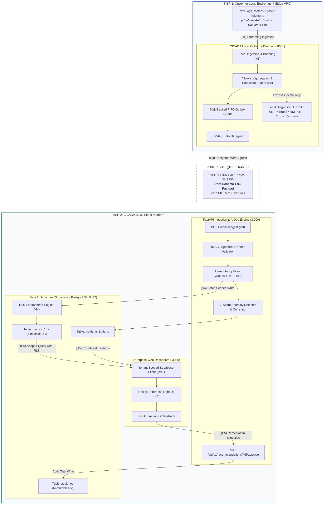
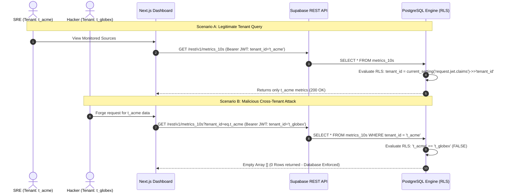
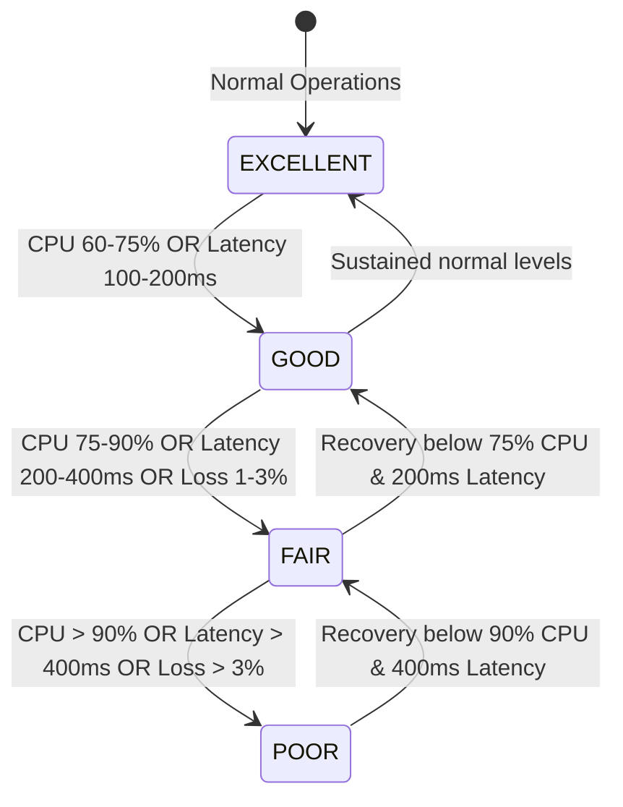

# CICADA 2026 — Phase 2: System Architecture & H1–H5 Data Flow

**Project**: CICADA (Continuous Intelligence & Cryptographic Architecture for Decentralized AIOps)  
**Hackathon**: CICADA 2K26  
**Module**: Phase 2 Deliverable — Technical Architecture, Component Specifications & Security Boundaries  
**Author**: Member 4 (Dashboard, Demo & Presentation Lead) on behalf of the CICADA Engineering Team  

---

## 1. System Overview & The Five Architectural Hops (H1–H5)

CICADA enforces a deterministic, zero-leakage pipeline across five distinct data-flow hops:



---

## 2. Detailed Technical Breakdown: Hops H1 through H5

### Hop H1: Raw Telemetry Generation to Local Ingestion
- **Source**: Enterprise application workloads, microservices, Linux host daemons, container stdout/stderr.
- **Destination**: CICADA Local Collector daemon (listening on Unix socket, named pipe, or local port `8001`).
- **Nature of Data**: Unfiltered, raw, and high-entropy logs. Contains operational telemetry intermixed with sensitive tokens:
  ```jsonl
  {"timestamp":"2026-11-20T16:20:01.120Z","level":"INFO","service":"auth-service","msg":"User login successful","user":"alice@enterprise.com","token":"eyJhbGciOi..."}
  {"timestamp":"2026-11-20T16:20:02.400Z","level":"ERROR","service":"payment-gw","msg":"Connection timeout to processor","card_last4":"4111","cvv":"***","password":"hunter2"}
  ```
- **Security Constraint**: **Hop H1 occurs exclusively within the customer's private host or Kubernetes pod network.** Telemetry at this stage is never exposed to external networks.

---

### Hop H2: Local Edge Redaction, Allowlisting & 10-Second Aggregation
- **Component**: CICADA Collector Aggregation & Redaction Core (`collector/`).
- **Processing Logic**:
  1. **Strict Field Discard**: Any unstructured message string, payload body, or raw metadata is permanently dropped from the outbound queue.
  2. **10-Second Time Window Alignment**: Events are bucketed into deterministic 10-second intervals based on event generation time:
     $$\text{window\_start\_utc} = \lfloor \frac{\text{event\_time}}{10\text{s}} \rfloor \times 10\text{s}$$
  3. **Pseudonymization**: Internal infrastructure identifiers (e.g. `k8s-pod-auth-deployment-78f9b-2xk81`) are converted to irreversible deterministic pseudonyms (e.g. `src-a9f1b2c3`) using a local salt.
  4. **Allowlist Rollup Computation**:
     - Computes $p95$ CPU utilization ($0.0 - 100.0\%$).
     - Computes $p95$ Memory utilization ($0.0 - 100.0\%$).
     - Computes total network bytes transmitted.
     - Computes $p95$ Request latency ($ms$) and packet loss percentage.
     - Increments security event counters (`login_failed_count`, `admin_actions_count`).
  5. **Disk-Backed Outbox FIFO Queue**: Assembled payloads are written to a durable disk-backed queue before network transmission to survive power outages or link disruptions.
- **Diagnostic API (`Tier 1 Local Only`)**:
  - `GET /local/raw`: Returns the last 50 raw unredacted log lines (used by local SREs and the Privacy Proof view).
  - `GET /local/egress`: Returns the exact JSON payload queued for transmission.
  - `GET /local/buffer`: Returns current outbox buffer depth and memory consumption.

---

### Hop H3: Signed & Encrypted HTTPS Egress to SaaS Cloud
- **Transport**: HTTPS over TLS 1.3 to SaaS Cloud endpoint `POST https://saas.cicada.io/api/v1/ingest`.
- **Payload Schema (`contracts/payload_schema.json`)**:
  ```json
  {
    "schema_version": "1.0.0",
    "tenant_id": "t_acme",
    "collector_id": "col-acme-prod-01",
    "sequence_number": 1042,
    "window_start_utc": "2026-11-20T16:20:00.000Z",
    "window_end_utc": "2026-11-20T16:20:10.000Z",
    "hmac_signature": "sha256=a7b8c9d0e1f2...",
    "metrics": [
      {
        "source_pseudonym": "src-a9f1b2c3",
        "source_type": "api_gateway",
        "cpu_p95": 42.5,
        "memory_p95": 61.2,
        "network_bytes_total": 1048576,
        "latency_p95": 85.4,
        "packet_loss_pct": 0.0
      }
    ],
    "security": {
      "login_failed_count": 0,
      "admin_actions_count": 2
    }
  }
  ```
- **Cryptographic Authentication**:
  - Every payload is signed using an HMAC-SHA256 signature calculated over the canonical serialized JSON body:
    $$\text{HMAC} = \text{HMAC-SHA256}(K_{\text{tenant}}, \text{CanonicalPayload})$$
  - The shared secret $K_{\text{tenant}}$ is securely provisioned in the collector environment via environment variable or Kubernetes Secret (`COLLECTOR_HMAC_SECRET`).
- **Zero-PII Guarantee**: No raw text, no customer PII, and no credentials ever cross Hop H3.

---

### Hop H4: Verification, Deduplication & Storage in PostgreSQL / Supabase
- **Component**: FastAPI Ingestion Service (Port `8000`) & Supabase Database (Port `5432`).
- **Processing Steps**:
  1. **Schema Validation**: Ingestion service validates payload against JSON Schema 1.0.0. Payloads with unrecognized properties or missing mandatory fields are rejected (`400 Bad Request`).
  2. **HMAC Signature Verification**: Fast path verification computes the expected HMAC using the tenant's registered secret. Payloads with mismatched signatures are immediately dropped (`401 Unauthorized`).
  3. **Idempotency & Deduplication Engine**:
     - Evaluates composite primary key: $(\text{tenant\_id}, \text{collector\_id}, \text{sequence\_number}, \text{window\_start\_utc})$.
     - If the record already exists (e.g. from network retry or replay), the request returns `200 OK (deduplicated)` without double-counting metrics.
  4. **Relational Persistence**:
     - Writes to `metrics_10s` table with `tenant_id` foreign key.
     - Evaluates health status against `contracts/health_thresholds.json` and updates `health_history`.
  5. **AIOps Pipeline Trigger**:
     - Evaluates metric deviation using moving z-scores:
       $$Z = \frac{x - \mu}{\sigma}$$
     - If $Z > 3.0$ or threshold exceeds Poor boundary (e.g. CPU > 90%), triggers an Alert and correlates related alerts into an Incident.

---

### Hop H5: SaaS / FastAPI to Next.js Enterprise Web Dashboard
- **Component**: Next.js Enterprise Light Dashboard (Port `3000`).
- **Query & Control Channels**:
  1. **Telemetry & Metrics Retrieval**:
     - Dashboard queries Supabase via `@supabase/supabase-js`.
     - The query carries the user's JWT containing their authenticated `tenant_id`.
     - **Database Row-Level Security (RLS)** guarantees the query execution plan in PostgreSQL only scans rows where `tenant_id = auth.jwt() ->> 'tenant_id'`. Cross-tenant queries return 0 rows at the database engine level.
  2. **Remediation & Action Orchestration**:
     - When an SRE reviews an AIOps recommendation, the dashboard sends:
       `POST /api/v1/recommendations/{id}/approve`
     - The FastAPI backend validates that the requesting operator has the `operator` or `admin` role for that tenant, triggers the execution script, and logs an immutable entry into `audit_log`.
  3. **Diagnostic Local Proof View**:
     - For authorized local operators viewing the Privacy Side-by-Side screen, the dashboard issues a client-side fetch to `http://localhost:8001/local/raw` to render the local edge comparison against the cloud metric state.

---

## 3. Row-Level Security (RLS) & Multi-Tenant Isolation

Tenant isolation is **cryptographically and architecturally enforced at the storage engine level**, never left to frontend filtering:



### PostgreSQL RLS Policies (`contracts/supabase/001_init.sql`)
```sql
-- Enable Row Level Security on Telemetry Tables
ALTER TABLE metrics_10s ENABLE ROW LEVEL SECURITY;
ALTER TABLE incidents ENABLE ROW LEVEL SECURITY;
ALTER TABLE collectors ENABLE ROW LEVEL SECURITY;

-- Policy: Restrict read operations strictly to authenticated tenant token
CREATE POLICY tenant_isolation_policy ON metrics_10s
  FOR SELECT
  USING (tenant_id = auth.jwt() ->> 'tenant_id');

CREATE POLICY tenant_isolation_incidents ON incidents
  FOR ALL
  USING (tenant_id = auth.jwt() ->> 'tenant_id');
```

---

## 4. Health Classification & Threshold Specification

System health is evaluated deterministically every 10 seconds against the official contract (`contracts/health_thresholds.json`):



| Health State | CPU Utilization ($p95$) | Request Latency ($p95$) | Packet Loss Rate | UI Indication & Rationale Requirement |
| :--- | :---: | :---: | :---: | :--- |
| **EXCELLENT** | $< 60\%$ | $< 100\text{ ms}$ | $0.0\%$ | Green badge. System performing within optimal SLAs. |
| **GOOD** | $60\% \le \text{CPU} < 75\%$ | $100\text{ ms} \le L < 200\text{ ms}$ | $< 1.0\%$ | Blue badge. Minor resource utilization, normal traffic load. |
| **FAIR** | $75\% \le \text{CPU} < 90\%$ | $200\text{ ms} \le L < 400\text{ ms}$ | $1.0\% \le \text{Loss} < 3.0\%$ | Amber badge. Degraded performance; reason explicitly logged. |
| **POOR** | $\ge 90\%$ | $\ge 400\text{ ms}$ | $\ge 3.0\%$ | Red badge. Urgent breach; triggers automatic incident creation. |

**Deterministic Rule**: Every transition to `FAIR` or `POOR` **must** carry a concrete, human-readable reason (e.g. `latency_p95 (482ms) > 400ms`).

---

## 5. Failure Handling, Outbox Buffering & Disaster Recovery

### 5.1. Network Outage & Link Severance
When the WAN connection between Tier 1 and Tier 2 fails:
1. The collector's HTTP client receives connection timeouts (`ECONNREFUSED` or `ETIMEDOUT`).
2. Telemetry payloads cannot egress and are routed to the **Local Disk-Backed FIFO Outbox Buffer**.
3. The collector updates its local heartbeat state:
   - `buffer_depth` increments per 10-second window.
   - Status transitions to `DEGRADED (Link Offline)`.
4. The local buffer retains up to 10,000 payloads on disk (configurable ring buffer).
5. **Recovery**: When the SaaS link restores, the collector drains the outbox in strict chronological sequence.
6. The FastAPI backend ingests the drained queue without dropping records or corrupting historical timeseries.

### 5.2. Clock Skew & UTC Timestamps
All system components enforce strict ISO-8601 UTC timestamps (`YYYY-MM-DDTHH:mm:ss.sssZ`). If a collector's host clock drifts by more than 30 seconds relative to the cloud ingestion server, the payload is flagged with a clock skew warning while still preserving the original window boundaries.

---

## 6. Security Guarantees & Non-Claims

To ensure absolute credibility during hackathon evaluation, CICADA explicitly delineates its security scope:

### What CICADA Strictly Guarantees:
1. **Zero Data Exfiltration Over Network (Hop H3)**: Raw logs, auth tokens, database connection strings, and customer PII are discarded before network transmission.
2. **Deterministic Cryptographic Authentication**: Unauthenticated or tampered payloads lacking a valid HMAC-SHA256 signature are rejected at the edge gateway.
3. **Database-Enforced Multi-Tenancy**: Data isolation between tenants is guaranteed by PostgreSQL Row-Level Security, preventing cross-tenant leakage even under compromised frontend states.
4. **Non-Repudiation for Actions**: All remediation commands require human approval and generate immutable cryptographic audit log records.

### What CICADA Does Not Claim:
1. **Host-Level Root Compromise**: CICADA does not protect against a malicious actor with root/kernel-level access to the customer's host operating system who directly intercepts unredacted memory before the collector processes it.
2. **Endpoint Hardware Tampering**: CICADA relies on standard Linux kernel security primitives and environment variable confidentiality within Tier 1.
3. **Global Multi-Cloud Synchronization**: Full multi-region active-active database replication is designed for post-hackathon enterprise deployment.
