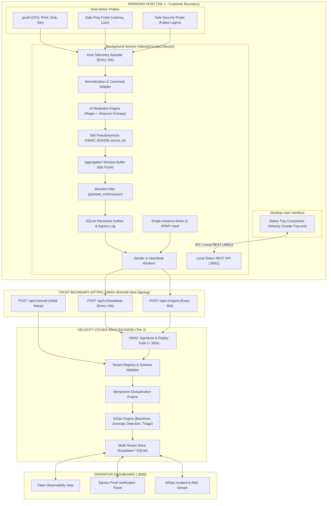

# Velocity Cicada — Windows Collector Architecture

## 1. Architectural Overview

Velocity Cicada Collector is an enterprise-grade observability agent for Windows that implements a **two-tier zero-trust architecture**:
- **Tier 1 (Customer Workstation):** Local continuous collection, regex credential redaction, cryptographic salt pseudonymization, and 60-second window aggregation. Raw customer data, usernames, and unredacted logs NEVER cross the trust boundary.
- **Tier 2 (SaaS Cloud Backend):** Ingestion gate enforcing HMAC-SHA256 authentication, replay verification, allow-list schema validation, multi-tenant isolation, and automated AIOps correlation.

---

## 2. High-Level Component Diagram



---

## 3. The 8-Stage Telemetry Pipeline

```text
[ COLLECT ]      psutil samples CPU, RAM, Disk, Network speeds; safe probes sample latency & security.
     ↓
[ NORMALIZE ]    Raw OS metrics converted into canonical structured event records.
     ↓
[ REDACT ]       Sensitive tokens, emails, IPs, JWTs, and high-entropy strings masked.
     ↓
[ PSEUDONYMIZE ] Local hostname hashed into 'src_xxxxxxxxxxxx' via HMAC-SHA256 with local salt.
     ↓
[ AGGREGATE ]    10-second metric slices held in memory and summarized into a 60-second window.
     ↓
[ ALLOW-LIST ]   Draft 2020-12 schema validation drops any unapproved fields (default-deny).
     ↓
[ SIGN ]         Serialized payload signed with HMAC-SHA256 (X-Timestamp, X-Signature headers).
     ↓
[ SEND ]         Queued in SQLite outbox, sent via HTTPS to SaaS with exponential backoff & retry.
```

---

## 4. Key Security & Resiliency Guarantees

1. **Zero Console Windows:**
   All subprocess calls (`ping.exe`, `wevtutil.exe`, `powershell.exe`) specify `CREATE_NO_WINDOW` (`0x08000000`) and `STARTF_USESHOWWINDOW` with `SW_HIDE`. The agent runs completely invisible to desktop users.
2. **Single-Instance Enforcement:**
   Windows Named Mutex `Global\VelocityCicadaCollector_Service_Mutex` guarantees only one service process runs at any time, preventing outbox file corruption and duplicate network requests.
3. **Decoupled Architecture:**
   The core service runs independently as a system service. Launching, closing, or crashing the System Tray application has zero impact on continuous background collection or SaaS transmission.
4. **Credential Protection (DPAPI):**
   Secrets stored in `config.json` are encrypted using Windows Data Protection API (`CryptProtectData`), restricting decryption to the local Windows machine context.
5. **Zero Data Loss Outage Resilience:**
   During network drops or SaaS maintenance, payloads accumulate in the SQLite `outbox` table. When connectivity returns, the collector drains buffered records sequentially, while the SaaS idempotency engine safely handles duplicate payload IDs.
